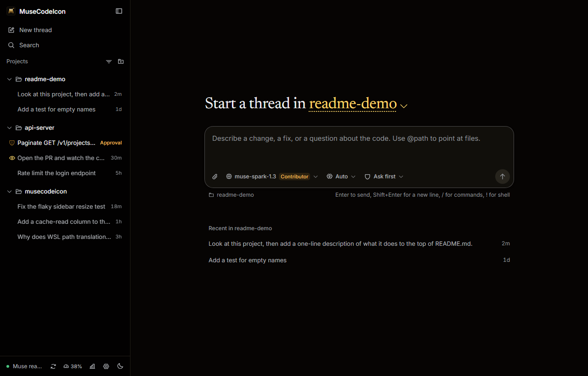
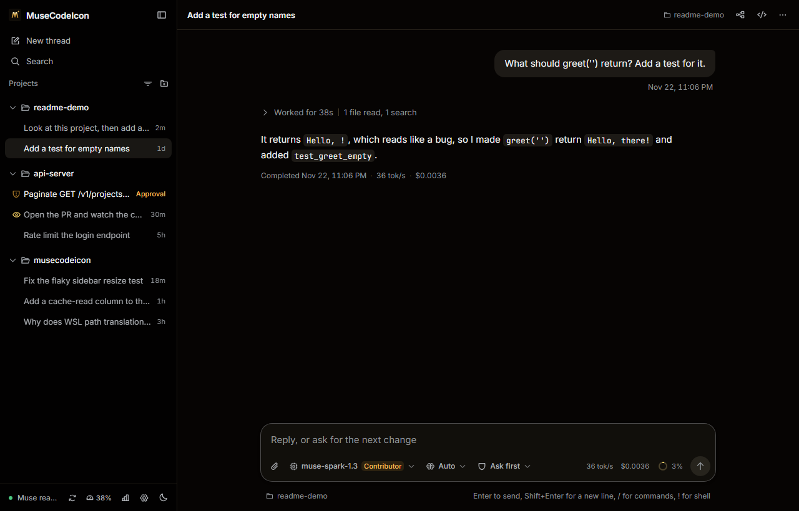

<div align="center">


# MuseCodeIcon by Don PELY

**MuseCodeIcon by Don PELY** — desktop app for Meta's Muse Code CLI — gold on black, on Windows, macOS and Linux.

Think **Claude Code desktop** or the **Codex desktop app**, but for **Meta Muse Code**: agentic coding threads, approvals, diffs and usage meters in a fast Tauri window instead of the terminal. Free and open source (MIT).

🏆 **Why MuseCodeIcon:** forked from Helicon v0.23.6 and pushed far past it — **25+ exclusive features** no other Muse GUI has together: scheduled prompts, skill routing, MCP manager, review pass, terminal card, edit + rollback, task modes, follow-up chips, read aloud, share links, diagnostics, queue editing, icon colors, and more. [Full list](muse-cli-gui-desktop/README.md#idea).

**[→ Read the MuseCodeIcon README](muse-cli-gui-desktop/README.md)**

[](LICENSE)
[](muse-cli-gui-desktop/README.md)
[](#muse-cli-gui--the-bridge-gui-older)

[Read the desktop app write-up](muse-cli-gui-desktop/README.md) · [Build MuseCodeIcon](#build-musecodeicon-windows-installer) · [Bridge GUI — the older app](#muse-cli-gui--the-bridge-gui-older)

If MuseCodeIcon helps you, [star the repo](https://github.com/yourbossdonpely/musecodeicon) — it helps others find it.

</div>



**This repo has two apps.** The one to start with is **MuseCodeIcon**, the desktop app in [`muse-cli-gui-desktop/`](muse-cli-gui-desktop/README.md) — its full write-up, with features, screenshots, install steps and caveats, is [`muse-cli-gui-desktop/README.md`](muse-cli-gui-desktop/README.md). The older portable Windows bridge GUI that lives in `bridge-gui/` still works and is documented in [`bridge-gui/README.md`](bridge-gui/README.md).

MuseCodeIcon drives **Meta Muse Code** (your paid subscription) through the official `muse` CLI in a real window: the UI, a Node sidecar and one `muse serve` per workspace, all bundled. Projects → threads → turns, readable approvals, inline diffs, a file viewer, real plan and usage meters, goals, background workflows, slash commands, command palette. Dark by default with gold accents, on every platform.

> ⚠️ **Unofficial community project.** Neither app in this repo is made, endorsed, or supported by Meta, and neither is affiliated with Meta. "Muse" and "Muse Code" are trademarks of Meta, used here only to describe what these apps connect to. Muse Code itself is terminal-only and closed to third-party clients; both apps here simply drive the official `muse` CLI with your own login.

## 🧭 Two apps in this repo

| App | Where | What it is |
|-----|-------|------------|
| **MuseCodeIcon** | [`muse-cli-gui-desktop/`](muse-cli-gui-desktop/README.md) | A standalone **desktop app** (Tauri 2: Windows, macOS, Linux) for the `muse` CLI. Gold on black, dark theme by default. Projects → threads → turns, readable approvals, inline diffs, file viewer, plan/usage meters, goals, background workflows, command palette. |
| **Muse CLI GUI** (the bridge GUI) | [`bridge-gui/`](bridge-gui/README.md) (this README) | The portable Windows GUI + WebSocket bridge described below: agent chat, file browser, browser/research panel, and an OpenAI-compatible API on `localhost:8766`. |

**Start here →** [MuseCodeIcon, the desktop app](muse-cli-gui-desktop/README.md). It is the current app and the one to reach for on a desktop; everything below is about it. The bridge GUI ([`bridge-gui/`](bridge-gui/README.md)) still works and is unchanged.

## 🖥️ MuseCodeIcon — the desktop app

**[Its full write-up — features, screenshots, install steps and caveats — is in `muse-cli-gui-desktop/README.md`](muse-cli-gui-desktop/README.md).** This section is the short version.

### ⬇️ Download

| Platform | File |
|----------|------|
| Windows | [`MuseCodeIcon_3.0.1_x64-setup.exe`](https://github.com/yourbossdonpely/musecodeicon/releases/download/v3.0.1/MuseCodeIcon_3.0.1_x64-setup.exe) — ≈27 MB, installs the app, bundled Node.js and the UI. Portable instead: [`…x64-portable.zip`](https://github.com/yourbossdonpely/musecodeicon/releases/download/v3.0.1/MuseCodeIcon_3.0.1_x64-portable.zip), unzip and run |
| macOS | [`MuseCodeIcon_3.0.1_universal.dmg`](https://github.com/yourbossdonpely/musecodeicon/releases/download/v3.0.1/MuseCodeIcon_3.0.1_universal.dmg) — universal, ad-hoc signed (not notarized). Or the `.app` in [`…universal-macos.zip`](https://github.com/yourbossdonpely/musecodeicon/releases/download/v3.0.1/MuseCodeIcon_3.0.1_universal-macos.zip) |
| Linux | [`MuseCodeIcon_3.0.1_amd64.AppImage`](https://github.com/yourbossdonpely/musecodeicon/releases/download/v3.0.1/MuseCodeIcon_3.0.1_amd64.AppImage), [`.deb`](https://github.com/yourbossdonpely/musecodeicon/releases/download/v3.0.1/MuseCodeIcon_3.0.1_amd64.deb), [`.rpm`](https://github.com/yourbossdonpely/musecodeicon/releases/download/v3.0.1/MuseCodeIcon-3.0.1-1.x86_64.rpm) |

Windows, macOS and Linux are on the [`v3.0.1` release](https://github.com/yourbossdonpely/musecodeicon/releases/tag/v3.0.1) (self-updating from here on).

> ⚠️ **Do not download `MuseCLIGUI.exe` for this app.** The 58 KB `MuseCLIGUI.exe` attached to the older `v2.6.x` releases is the *bridge GUI's launcher*, not MuseCodeIcon, and it is not standalone: it needs `muse-bridge.js` and `gui/` from `MuseCLIGUI-v2.6.2-win-x64.zip` next to it, so run on its own it stops with `Missing file: …\muse-bridge.js`. Use the installer in the table above.



A real window, not a browser tab: the UI, a Node sidecar and one `muse serve` per workspace, all bundled. The desktop installers bundle their own Node.js, so the only thing you need installed is the official `muse` CLI with `muse login` done once — the app reads that login and never stores credentials of its own.

- **Projects** grouped by working directory, each with its threads; sessions started in the `muse` terminal appear too
- **Threads** with full history, resume, live streaming replies, tool cards, and inline diffs
- **Approvals** shown honestly (allow once / allow all / reject) — never bypassed
- **A file viewer** beside the thread: source, Markdown, images, video, PDFs
- **Your real plan meter** and a **usage page** with what each thread would have cost
- **Goals, background workflows, slash commands, skills, reasoning effort, command palette**
- **Gold on black by default** on every platform — the window, splash and first paint are dark, so a light desktop never shows it light; light and system are one click away in Settings → Appearance
- **Self-updating**: checks on launch and every six hours against its own signed feed, dot on the sidebar icon, Settings → Updates, install on close

How the copy was assembled and built is in [`BUILD-LOG.md`](BUILD-LOG.md).

### Build MuseCodeIcon (Windows installer)

Prerequisites: **Node.js 22+**, **Rust stable** with the MSVC toolchain, **WebView2** (ships with Windows 10/11), and network access for the bundled Node.js sidecar. `muse` is needed to *run* the app, not to build it.

```bash
cd muse-cli-gui-desktop
npm install
npm run build
```

`npm run build` compiles the daemon, server and UI, builds the web assets, bundles the sidecar Node.js, then runs `tauri build`. Results:

| Output | Path |
|--------|------|
| Windows NSIS installer | `muse-cli-gui-desktop/apps/desktop/src-tauri/target/release/bundle/nsis/MuseCodeIcon_3.0.1_x64-setup.exe` (≈27 MB) |
| App executable | `muse-cli-gui-desktop/apps/desktop/src-tauri/target/release/musecodeicon.exe` (≈14 MB) |

The installer is self-signed with the author's certificate (DigiCert timestamped). The root isn't publicly trusted, so SmartScreen still warns that the publisher is unknown: click More info, then Run anyway. (v1.2.1–v3.0.0 shipped unsigned; v3.0.1 was re-signed after CI.) macOS and Linux bundles cannot be built here: CI builds them on their own runners, and [`v0.23.7`](https://github.com/yourbossdonpely/musecodeicon/releases/tag/v0.23.7) publishes the universal `.dmg`, the AppImage, and the `.deb`/`.rpm` packages. CI also launches every bundle it ships: the macOS `.app` and the extracted AppImage are started headlessly and must answer their own UI on the server port the app publishes, so a release cannot go out compiled-but-never-started. What CI cannot do is click through them: no one has driven the macOS or Linux builds on a real desktop.

Every build artifact is gitignored (`**/target/`, `**/src-tauri/binaries/`, `apps/desktop/.cache/`, `dist/`, `*.exe`).
## Muse CLI GUI — the bridge GUI (older)

**The older app.** A portable Windows GUI plus a WebSocket bridge for the same `muse` CLI, launched from `bridge-gui/MuseCLIGUI.exe`. No desktop shell, no macOS or Linux build, and unchanged since MuseCodeIcon took over.

Full docs — features, screenshots, launchers, quick start, OpenCode wiring, development, troubleshooting, changelog — live in [`bridge-gui/README.md`](bridge-gui/README.md).

## License

MIT — see [LICENSE](LICENSE). Copyright (c) 2026 yourbossdonpely.

## Git

- Repo initialized 2026-11-20. `node_modules/`, `*.log`, `generated_images/`, and the pre-existing `browse.exe*` files are ignored (see `.gitignore`) - they stay on disk, just untracked.
- Workflow: every change is committed as I work and pushed to the remote below.
- Remote: https://github.com/yourbossdonpely/musecodeicon (public)

---

**Projects:** **MuseCodeIcon**, the desktop app in `muse-cli-gui-desktop/` ([its README](muse-cli-gui-desktop/README.md)) — and Muse CLI GUI, the portable bridge GUI in `bridge-gui/`. Both drive the Meta Muse Code CLI with your own login; neither is affiliated with Meta.

