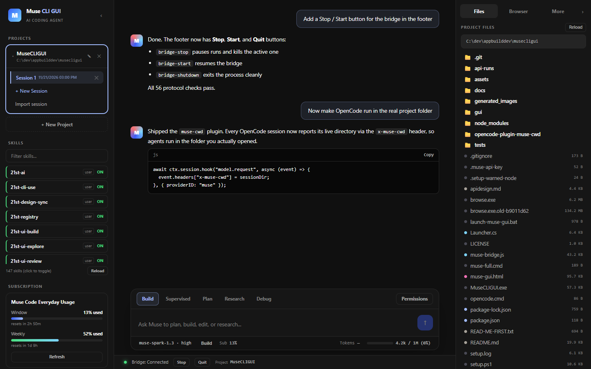
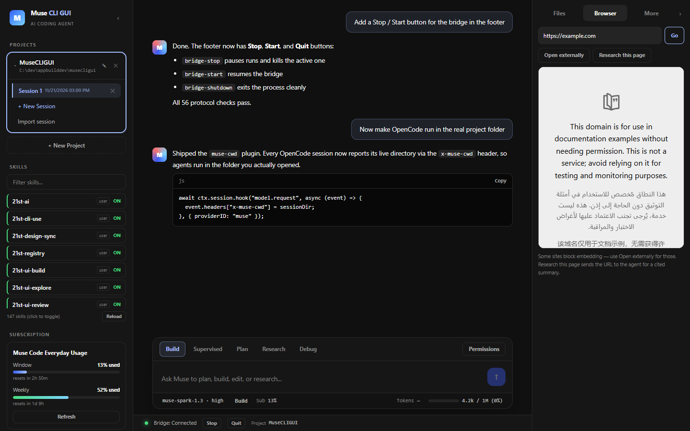
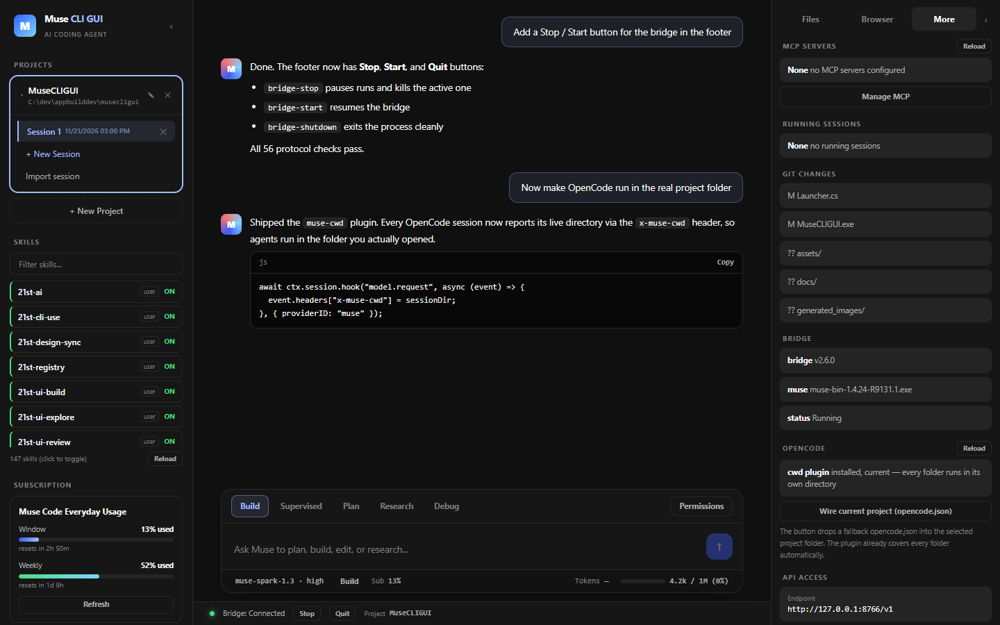

# Muse CLI GUI by Don PELY — the bridge GUI (older app)

The portable Windows GUI + WebSocket bridge for the `muse` CLI. Unchanged since
MuseCodeIcon took over; it lives on here for the machines still running it.

**Docs:** the full write-up is below — features, screenshots, launchers, quick start,
OpenCode/FreeBuff wiring, development, troubleshooting, changelog. The current app is
[MuseCodeIcon](../muse-cli-gui-desktop/README.md); `READ-ME-FIRST.txt` in this folder
is the two-line version of this one.

Layout (all paths relative to this folder):

| Path | What it is |
|------|------------|
| `MuseCLIGUI.exe` | One-click launcher (needs `muse-bridge.js` + `gui/` beside it) |
| `muse-bridge.js` | The bridge server (`ws://localhost:8765` + OpenAI-compatible `:8766/v1`) |
| `gui/` | React GUI source; `gui/dist/` is the committed single-file build the exe opens |
| `muse-gui.html` | Legacy single-file GUI, kept as a fallback |
| `tests/` | Bridge protocol suite (`npm install`, then `npm run test:bridge`) |
| `setup.ps1` | First-run setup brain (Node.js, deps, API key, OpenCode wiring) |
| `launch-muse-gui.bat`, `start-bridge.cmd`, `stop-bridge.cmd` | Portable launchers |
| `muse-full.cmd`, `opencode.cmd` | Muse CLI / OpenCode shims |
| `Launcher.cs` | Launcher source (rebuild with `csc.exe`, then re-sign) |
| `wire-opencode-projects.js` | One-shot OpenCode project-folder wiring |
| `opencode-plugin-muse-cwd/`, `opencode-agents/` | `muse-cwd` plugin + supervised/research/debug agents |
| `docs/screenshots/`, `assets/` | GUI screenshots and launcher art |
| `apidesign.md`, `uiredesign.md` | Bridge-era design notes |

This folder is self-contained: copy or move it anywhere and it runs from there.

---

**The older app.** A portable Windows GUI plus a WebSocket bridge for the same `muse` CLI, launched from `MuseCLIGUI.exe` in this folder. No desktop shell, no macOS or Linux build, and unchanged since MuseCodeIcon took over. Everything from here down documents it.

A custom GUI that drives **Meta Muse Code** (your paid subscription) through the official `muse` CLI — no permission prompts unless you want them, live streaming agent runs, real skills/models/usage from the CLI, a real file browser, a browser + deep-research panel, and per-run permission control. It also serves an OpenAI-compatible API, so OpenCode or FreeBuff can drive the same subscription.

**Portable:** this folder is self-contained — copy or move it anywhere and it runs from there. All launchers resolve paths from their own location; no folder is hardcoded.

## Features

| Area | What it does |
|------|--------------|
| **Agent chat** | Live streaming replies, live tool-call cards, run log, Stop button, multi-turn memory (transcript sent with each run), stable session id per GUI session |
| **Modes** | Build (full speed), Supervised (sandbox on), Plan (read-only), Research (web + citations), Debug (reproduce/diagnose/fix) |
| **Permissions** | Mode presets plus every flag individually: yolo, approval mode, trust workspace, sandbox, sandbox network, file writes, shell, web tools — with a live CLI preview |
| **Models** | Real list from `muse exec --list-models`, reasoning effort, contributor mode |
| **Projects** | Add/select/delete projects, sub-sessions per project, messages persisted per session, session export to Markdown |
| **Skills** | Real list from `muse skills list`, enable/disable in the real CLI config |
| **File browser** | Real filesystem tree for the selected project, file preview, attach files to prompts (up to 5) |
| **Browser tab** | URL preview + open externally + one-click "Research this page" |
| **More tab** | MCP servers, running sessions (`muse sessions`), git status / changed files, bridge info, API access (endpoint + key), OpenCode wiring (plugin status + one-click `opencode.json`) |
| **Bridge controls** | Stop / Start / Quit the bridge from the footer status bar — no more hunting the console window |
| **Subscription** | Live tier + window/weekly allowance from `muse usage`, refreshed after every run |
| **Token counts** | Real input/output tokens per run from the CLI event stream |
| **Demo Mode** | GUI stays usable with scripted replies when the bridge is down |
| **Proxy API** | OpenAI-compatible `POST /v1/chat/completions` (+ `/v1/models`, `/health`) on localhost:8766 — use the subscription from OpenCode or FreeBuff |
| **Follow-ups** | Three clickable next-step chips under every reply (in-band, zero extra cost) |
| **@ mentions** | Type `@` in the composer for file autocomplete; mentioned files auto-attach |
| **Checkpoints** | Every run snapshots git state; review the diff and Undo with one click |
| **Share links** | Localhost replay page per session, copy-link from the More tab |
| **Compact** | One-click session summarization into a fresh session at 80% context |
| **Parallel runs** | Up to 3 concurrent agent runs, each with its own card and stop button |
| **Read aloud** | Speaker button on every reply; female-English voice preferred, picker in More |
| **Diagnostics** | Post-run syntax checks (JS/JSON/Python/PS1/TS) with issue list + manual re-run |
| **OpenCode modes** | Build/Supervised/Plan/Research/Debug agents in OpenCode map to matching execution modes |

## 📸 Screenshots

**Agent chat** — streaming replies, live tool cards, real file tree, skills, and subscription meters:



**Browser tab** — preview any page beside your chat, research it with one click:



**More tab** — MCP servers, sessions, git changes, bridge status, OpenCode wiring, and API access:



## How It Works

- The GUI (React, single-file `gui/dist` build) talks WebSocket to `muse-bridge.js` on `ws://localhost:8765`. Legacy single-file `muse-gui.html` is kept as a fallback.
- The bridge spawns the real `muse` binary directly (`muse-bin-*.exe`, newest wins — falls back to `muse.cmd`, then `muse` on PATH) and streams `muse exec --json` events: text deltas, tool/task lifecycle, token usage, terminal result.
- Prompts travel via `--prompt-file`, so any text (quotes, symbols, newlines) is passed safely with zero shell-quoting risk.
- Each run executes inside the selected project's folder. The bridge refuses to run when the OS temp folder is inside the project folder (the Muse runtime fails there — e.g. never pick your home folder as a project).
- Old `{command}`-only messages still work (legacy `{type:'output'|'error'}` reply).

<details>
<summary><b>Bridge protocol (for hackers)</b></summary>

Client sends `{id, action, ...}`. Requests get `{id, type:'result', ok, data|error}`; `exec` streams `exec-start / exec-delta / exec-tool / exec-log / exec-usage / exec-diagnostics / exec-done`. Up to 3 concurrent `exec` runs per socket; `stop` takes an optional `runId` (omit to stop all).

Actions: `exec` (command, cwd, mode, model, effort, contributor, sessionId, maxSteps, flags, history, context, provider), `stop`, `ping` (now reports `paused`), `bridge-stop`, `bridge-start`, `bridge-shutdown`, `opencode-wire`, `opencode-status`, `checkpoint-create`, `checkpoint-undo`, `share-create`, `summarize`, `diagnose`, `skills-list`, `skills-set`, `models-list`, `usage`, `mcp-list`, `sessions-list`, `fs-list`, `fs-read`, `git-status`.

`MUSE_CMD` may point at a `.js` stub (run with node) — the test suite uses this. `MUSE_BRIDGE_PORT` overrides the port.

</details>

## Launchers (all portable)

- `launch-muse-gui.bat` — One click: starts the bridge if needed, then opens the GUI
- `start-bridge.cmd` — Runs the bridge server (installs `ws` dependency on first run)
- `stop-bridge.cmd` — Stops the bridge (same as the Quit button in the GUI footer)
- `muse-full.cmd` — Launches Muse CLI directly with all permission flags disabled
- `opencode.cmd` — Shim for the OpenCode desktop CLI
- `setup.ps1` — First-run setup brain (run by the exe): downloads Node.js if missing, installs the ws dependency, checks the muse CLI, persists the API key, wires the OpenCode provider and offers to restart OpenCode when wiring changes

## 🚀 Quick Start

1. Double-click **`MuseCLIGUI.exe`** (or `launch-muse-gui.bat`). If Windows SmartScreen asks, choose More info > Run anyway. First run sets up everything automatically: Node.js (downloaded if missing), dependencies, API key, and OpenCode wiring.
2. Click **+ Add Project**, enter a name and a real project folder (not your home folder).
3. Pick a mode in the toolbar (Build / Supervised / Plan / Research) or open **Permissions** to tune flags.
4. Click the model stat to pick a model/effort; type below and Send. Stop interrupts a run.
5. Browse real files on the right; click a file to preview and **Attach to prompt**; use the Browser tab for page previews and one-click research.

## Use with OpenCode / FreeBuff (OpenAI-compatible API)

The bridge doubles as an OpenAI-compatible server, so your Muse subscription works two ways: the built-in GUI, or any external client that supports custom OpenAI endpoints (verified live with OpenCode 2026-11-21).

- **Endpoint:** `http://127.0.0.1:8766/v1` (localhost only, never exposed to the network)
- **API key:** GUI Inspector -> More -> API access (copy button), or the `.muse-api-key` file next to `muse-bridge.js` (auto-created on first run, never committed to git)
- **Models:** live from `muse exec --list-models` (e.g. `muse-spark-1.3`); `GET /v1/models` lists them
- **Context:** all four Muse models have a 1,048,576-token window (Meta Model API docs); per-call token usage is reported on buffered + stream responses so clients can show used-vs-total context. Reported input/output is metered from the client's own request/response size (the CLI's internal ~38k baseline is kept in the bridge log only, not billed to the client's meter)
- **Calls:** `POST /v1/chat/completions`, buffered or SSE (`stream: true`); send `{"metadata": {"cwd": "C:\\proj"}}` to run in a folder; max 3 concurrent runs
- **Isolation:** without `metadata.cwd`, each API call runs in a fresh empty scratch dir (auto-deleted afterwards) - no shared files, no cross-talk between clients or sessions. For real projects the setup installs a global `muse-cwd` OpenCode plugin that sends the live session directory as an `x-muse-cwd` header on every request, so **every** folder you open runs in its own directory with no per-project file and no restart. As a fallback the setup also auto-wires every known OpenCode project folder (project-level `opencode.json` body merge, re-synced each launch): `{"muse": {"body": {"metadata": {"cwd": "C:\\path\\to\\project"}}}}`, and the GUI (More tab → OpenCode) can wire any folder on demand

OpenCode provider block for `~/.config/opencode/opencode.json`:

```json
"muse": {
  "name": "Muse CLI GUI",
  "env": ["MUSE_BRIDGE_API_KEY"],
  "package": "@opencode/ai/providers/openai-compatible",
  "settings": { "baseURL": "http://127.0.0.1:8766/v1" },
  "models": { "muse-spark-1.3": { "name": "muse-spark-1.3" } }
}
```

Set the `MUSE_BRIDGE_API_KEY` env var to the key, then fully restart OpenCode (desktop app AND its background service predate the key otherwise) and pick a `muse/...` model. Gotcha we hit: the background service inherits env at launch, so a stale service says Invalid API key until restarted.

FreeBuff / other clients: add a custom OpenAI-compatible provider with the endpoint + key above. (FreeBuff custom-provider support is unconfirmed - your client runs locally, so the localhost endpoint is reachable; try it and see.)

Cost note: every API call spends subscription prompts (one agent run per call).

**Execution modes in OpenCode:** the setup installs `supervised`, `research`, and `debug` primary agents into `~/.config/opencode/agents/` (built-in `build` and `plan` work as-is). The `muse-cwd` plugin sends the session agent as an `x-muse-mode` header, and the bridge applies the matching mode: same prompt framing plus matching CLI flags (plan is read-only via `--disable-write`/`--disable-shell`; supervised/research keep the sandbox on). Per-request `{"metadata": {"mode": "plan"}}` overrides the header.

## Development (GUI source + tests)

- GUI source lives in `gui/` (React + TypeScript + Vite + Tailwind, single-file `dist/` build).
- `cd gui && npm install`, then `npm run dev` (dev server), `npm test` (unit + component), `npm run test:e2e` (needs stub bridge — see below), `npm run build` (rebuilds committed `gui/dist`).
- Bridge protocol suite: `npm install` here once, then `npm run test:bridge` (self-contained: spawns stub-backed bridge, 30 checks).
- Rebuilding the exe after `Launcher.cs` changes: `C:\Windows\Microsoft.NET\Framework64\v4.0.30319\csc.exe /target:winexe /win32icon:assets\app.ico /out:MuseCLIGUI.exe /reference:System.Windows.Forms.dll Launcher.cs`, then re-sign it with `signtool` before release.
- The exe/launcher open `gui/dist/index.html`, falling back to legacy `muse-gui.html` if dist is absent.

## Environment Overrides (optional)

| Variable | Default | Purpose |
|----------|---------|---------|
| `MUSE_CMD` | newest `muse-bin-*.exe`, else `muse.cmd`, else PATH | Which Muse executable the bridge runs (or a `.js` stub for tests) |
| `MUSE_BRIDGE_PORT` | `8765` | Bridge port (must match `BRIDGE_URL` in `muse-gui.html`) |

## Requirements

- **A Muse Code subscription** (any plan) — the app drives the official `muse` CLI with whatever plan you have signed in.
- **Node.js** on PATH (or use the release zip, which bundles it).
- **The official `muse` CLI** installed and logged in.
- Models are discovered live via `--list-models` (Spark, Wonder, Ember families); contributor variants via `--contributor-mode`. Usage allowances depend on your plan — watch the Subscription panel.

## Important Notes

1. **Subscription keys only work in the official `muse` CLI** (`client_attestation_denied` elsewhere). This GUI works by driving that CLI — nothing bypasses Meta's client check.
2. **Headless runs cannot answer approval prompts**, so the practical approval default here is `never`; use Supervised/Plan modes (sandbox on, writes/shell gated) when you want guardrails.
3. **Bridge must be running** for real CLI control (`launch-muse-gui.bat` starts it; otherwise Demo Mode).
4. **Moved folder?** If you pinned the old taskbar shortcut, delete it and re-pin `launch-muse-gui.bat` from the new location.

## Troubleshooting

| Problem | Solution |
|---------|----------|
| GUI won't connect | Run `start-bridge.cmd`, then click the status bar to retry |
| "temp folder is inside" error | Pick a project folder that does not contain the OS temp dir (never your home folder) |
| No projects showing | Click "+ Add Project" and add one, then select it |
| File browser empty/errors | Select a project first; check the folder path exists |
| Model not changing | Click the model stat in the status bar |
| Bridge crashes | Restart with `start-bridge.cmd` from this folder |
| Can't stop the bridge / console window | Click **Stop** (pause) or **Quit** (exit) in the GUI footer, close the window titled "Muse Bridge", or run `stop-bridge.cmd` |
| OpenCode agent runs in a temp/scratch folder | Relaunch the exe once (installs the `muse-cwd` plugin), then restart OpenCode; every folder then runs in its own directory automatically |

## Verification (all observed passing)

- 29 bridge protocol tests against a stub CLI (streaming, stop, validation, escape-blocking, legacy compat)
- 21 end-to-end GUI tests in headless jsdom against the stub-backed bridge (connect, skills toggle, models, permissions, projects, real file tree, preview, attach, streaming, tool cards, tokens, browser, research, MCP/sessions/git, stop)
- Live run through the real `muse` exe: echo provider streams correctly; 1 approved subscription prompt returned exactly `GUI_OK`
- Real CLI exit codes confirmed 0 for `usage`, `skills list`, `--list-models`, `mcp list`, `sessions`, `exec`

## Future Enhancements

- In-GUI file editing (currently: browse/view/attach; the agent edits)
- Checkpoints/undo with diffs (shadow history)
- Slash commands and custom agent modes
- Multi-run queue and parallel sessions

## Changelog

## [v2.7.0] - 2026-11-25

- **Follow-up suggestion chips**: every reply ends with 3 clickable next steps (parsed from an in-band block — zero extra subscription prompts), with mode-aware fallback chips when the model omits them.
- **`@` file mentions**: autocomplete in the composer, nested paths included; mentioned files auto-attach on send.
- **Checkpoints + undo**: each run snapshots git state before starting; checkpoint entries show the diff and offer two-click Undo (tracked files restored, new untracked files safely block).
- **Share links**: one-click localhost replay page per session from the More tab (expires on bridge restart).
- **Auto-compact**: Compact button plus an 80%-context nudge; summarizes into a fresh session, history preserved.
- **Parallel runs**: up to 3 concurrent agent runs with per-run cards and stop buttons; `stop` takes `runId`.
- **Read aloud**: speaker button on every reply (Web Speech, female English preferred, voice/speed picker in More, code-aware text cleaning).
- **Post-run diagnostics**: zero-install syntax checks (JS/JSON/Python/PS1/TS-when-present) over git-changed files after each run, plus a manual button.
- **OpenCode modes**: supervised/research/debug primary agents auto-installed; the plugin maps the session agent to matching bridge execution flags (built-in plan/build work with no config).
- Full suites green: 76/76 protocol, 113/113 GUI unit, 5/5 GUI e2e.

## [v2.6.2] - 2026-11-21

- **Brand + presentation**: new application logo (amber M terminal mark) embedded in `MuseCLIGUI.exe` (launcher 3.3.0, still signed), shown in the README header, and a revamped README with badges, hero screenshot, and Browser/More tab walkthrough shots.
- Full suites green (unchanged): 56/56 protocol, 81/81 GUI unit, 5/5 GUI e2e.

## [v2.6.1] - 2026-11-21

- **Token-count fix for OpenCode**: the bridge used to report the CLI's internal input total (~38k invisible baseline on every call) as the request's `prompt_tokens`, so a 12-word prompt showed ~87k and OpenCode's meter accumulated phantom tokens every turn. API usage is now metered from the client's own request/response size (~4 chars/token): the same 10-word prompt reports 19 in / 1 out. CLI reals stay visible in the bridge log (`cliIn`/`cliOut` vs `repIn`/`repOut`), and `MUSE_DEBUG_API=1` logs per-request composition for future diagnosis.
- Full suites green: 56/56 protocol, 81/81 GUI unit, 5/5 GUI e2e (unchanged).

## [v2.6.0] - 2026-11-21

- **Bridge Stop/Start/Quit in the GUI footer**: the "Bridge: Connected" bar now has Stop (pauses runs, kills the current one), Start (resumes), and Quit (exits the bridge process; the GUI reconnects automatically when you relaunch the exe). New `bridge-stop` / `bridge-start` / `bridge-shutdown` actions, `ping` reports `paused`, and chat/exec refuse cleanly while stopped. The bridge console window is now titled "Muse Bridge" so closing it is an obvious stop, plus a new `stop-bridge.cmd` helper.
- **OpenCode always runs in the real project folder**: new global `muse-cwd` plugin (auto-installed by setup into `~/.config/opencode/plugins/`) sends the live session directory as an `x-muse-cwd` header on every muse-model request — new folders work immediately with no `opencode.json` and no restart. The bridge accepts the header (same validation as `metadata.cwd`); per-project `opencode.json` wiring stays as a fallback, and the GUI More tab → OpenCode section shows plugin status with a one-click "Wire current project" button (`opencode-wire` / `opencode-status` actions).
- Full suites green: 56/56 protocol (new pause/header/wire/shutdown checks), 81/81 GUI unit, 5/5 GUI e2e.

## [v2.5.5] - 2026-11-21

- **No more manual OpenCode restarts**: when setup wires a new project (or the global provider), the launcher offers to restart OpenCode itself with one click. Launcher 3.2.0.


## [v2.5.4] - 2026-11-21

- **Automatic per-project directories**: new wire-opencode-projects.js reads OpenCode's project list and drops the cwd wiring into every project folder (merge-safe, backed up, home/temp skipped). Runs on each exe launch, so new projects are picked up automatically.


## [v2.5.3] - 2026-11-21

- **One-click setup**: MIT LICENSE added (shows on GitHub); new setup.ps1 run by the exe on every launch (idempotent): downloads portable Node.js when missing, bootstraps the ws dependency, checks the muse CLI, persists the API key env var, and auto-wires the OpenCode muse provider with backups. Launcher 3.1.0 (fixed a trailing-backslash quoting hang found in live testing).


## [v2.5.2] - 2026-11-21

- **API run isolation fix**: calls without metadata.cwd used to run in the bridge folder, so OpenCode agents rummaged our repo and answered from our files. Each call now gets a fresh empty scratch dir (auto-cleaned), verified live (agent reports api-runs/run-XXX, empty). Stream failures now surface their reason as a final chunk instead of silent empty-stop.
- Full suites green: 42/42 protocol (new api-scratch-clean check), 76/76 GUI.


## [v2.5.1] - 2026-11-21

- **Context reporting for OpenCode**: SSE streams now attach real token usage to the final chunk (buffered mode already did), so OpenCode accumulates used context - live-verified (input 42398 / output 21 on a test call, previously 0/0). All four Muse models confirmed at a 1,048,576-token window (Meta docs): OpenCode limit.context set for each, and the GUI prefills the same windows with user override still winning.
- Full suites green: 41/41 protocol, 76/76 GUI.


## [v2.5.0] - 2026-11-21

- **OpenCode verified end-to-end**: the proxy API drives a real Muse subscription inside OpenCode - standalone GUI or external client, your choice. README documents setup for OpenCode + FreeBuff.
- Version bump: bridge 2.5.0, GUI requires bridge >= 2.5.0. Full suites green: 40/40 protocol, 75/75 GUI.


## [GUI restyle] - 2026-11-21

- **OpenCode-look restyle** from real tokens extracted from the OpenCode desktop bundle: layered dark greys, blue accent, Inter/IBM Plex Mono. Styled code blocks, live cursor, thinking/shimmer/pulse animations added (all were unstyled); Sub % folded into the composer status bar. All functionality and tests unchanged (75/75).


## [v2.4.1] - 2026-11-21

- **Proxy stream fix**: SSE now ends with a finish_reason stop chunk before [DONE]. Without it OpenCode treated every reply as truncated and retried (live-test finding). New api-stream-finish protocol check; suite 40/40 green.
- OpenCode wiring validated live: clean opencode.json (corrupt concat fixed, muse provider added), old muse-code plugin retired, opencode run --model muse/muse-spark-1.3 returns step-finish reason=stop with zero retries.


## [v2.4.0] - 2026-11-21

- **OpenAI-compatible proxy API** on the bridge (`http://127.0.0.1:8766/v1`, localhost-only, bearer key persisted in gitignored `.muse-api-key`): `GET /health`, `GET /v1/models`, `POST /v1/chat/completions` (buffered + SSE `stream: true`), `metadata.cwd` per call, max 3 concurrent agent runs. Powers OpenCode/FreeBuff wiring; spend comes from the user's own Muse subscription.
- Bridge refactor: shared exec engine drives GUI (WS :8765) and HTTP; new `api-info` WS action exposes endpoint + key to the GUI.
- GUI: Inspector More tab gains an "API access" section showing endpoint + key with copy button; MIN_BRIDGE bumped to 2.4.0 (older bridges get an update banner).
- Protocol suite: 39/39 green (incl. 9 new HTTP checks: health/auth/models/chat/stream/400s/404). GUI suite: 75/75 incl. new API-panel test. (updated as I work)

- **2026-11-20, v3.0.0 React GUI:** complete rebuild in React + Vite + Tailwind (new amber agent-console design, thinking narration, typed tool cards, markdown answers, checkpoints, folder picker, dual usage bars, welcome hero, session import/export, MCP dialog, slash commands, send queue, checkpoint diffs). 68 unit + 5 E2E + 30 protocol tests green. Legacy single-file `muse-gui.html` kept as fallback.
- **2026-11-20, modes+compat:** new Debug mode (reproduce/diagnose/fix/verify); bridge/GUI version handshake with an outdated-bridge banner (kills the "Unknown action" class of confusion); proxy research in `apidesign.md`.
- **2026-11-20, v2.0.1:** `MuseCLIGUI.exe` one-click launcher, ready-to-run zip with bundled Node.js, bridge prefers bundled node, consistent Muse CLI GUI naming.
- **2026-11-20, release v2.0.0:** published on GitHub Releases (https://github.com/yourbossdonpely/musecodeicon/releases/tag/v2.0.0).
- **2026-11-20, launcher reliability:** fixed `start-bridge.cmd` batch parse error (a `(...)` comment inside a block aborted the script, so the window blinked off) and the `launch-muse-gui.bat` port check (`findstr` needs `/C:` for patterns with spaces - it always saw the port as busy and skipped the bridge). The launcher now starts the bridge if needed, waits for the port, then opens the GUI, and stays open with the error if the bridge fails.
- **2026-11-20, stuck "thinking" fix:** the GUI now surfaces run failures (e.g. a project folder containing the OS temp dir) instead of hanging on "Muse is thinking", warns if the bridge takes over 45s to start a run, and the bridge ignores stdin (no stdin hangs) plus logs every run start/finish/reject to its window.
- **2026-11-20, v2 release:** streaming exec, permissions + modes, real skills/models/usage/MCP/sessions, real file browser, browser + research tab, stop button, token counts (see Features).
