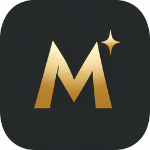
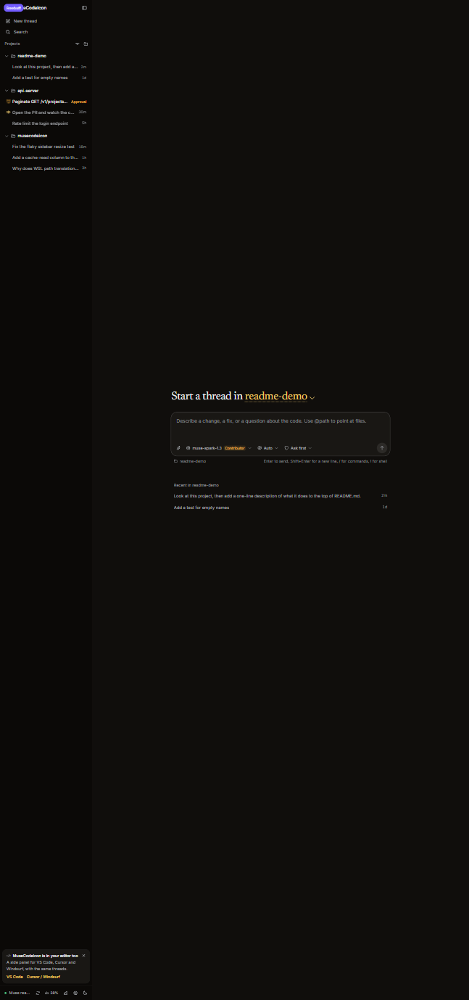
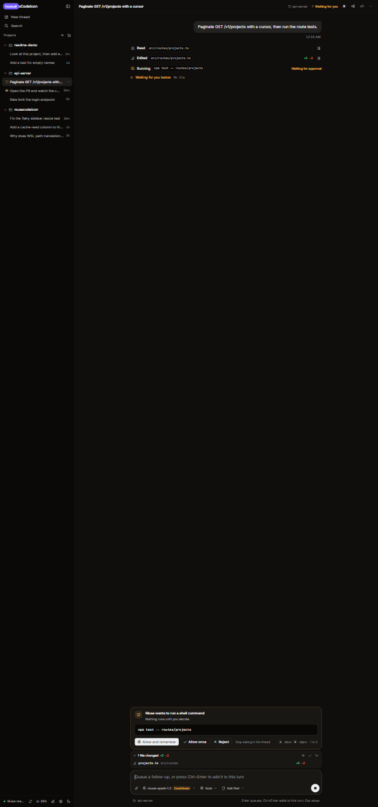
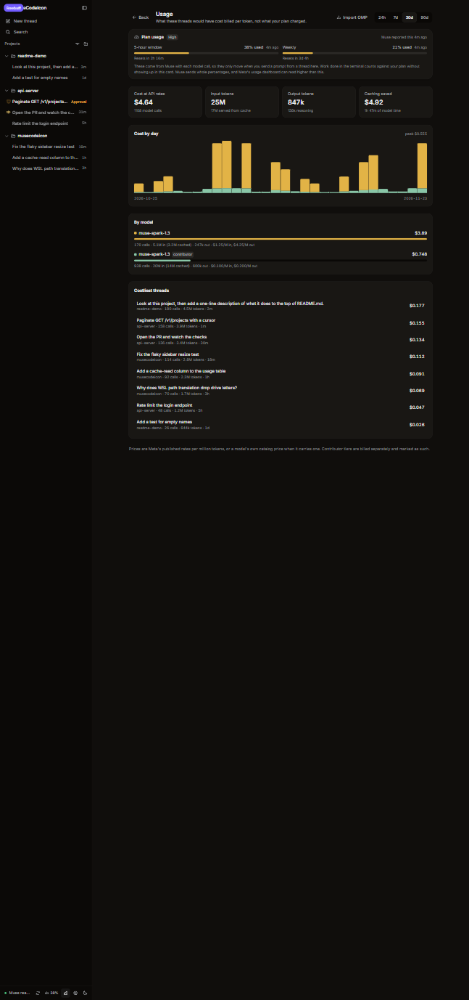
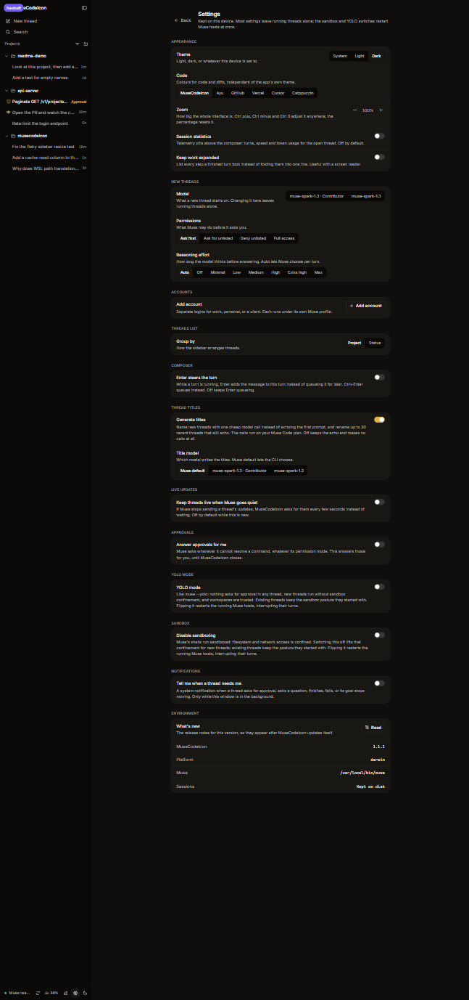

<div align="center">



# MuseCodeIcon

**A free, MIT-licensed desktop app (Windows, macOS, Linux) for Meta's Muse Code CLI.**
**Dark and gold, on every platform.**

> **Unofficial community project — not made, endorsed, or supported by Meta. Not affiliated with Meta.**

**Download:** No MuseCodeIcon release has been published yet. Build from source (see [From source](#from-source)); the Windows installer builds to `apps/desktop/src-tauri/target/release/bundle/nsis/`. (Windows / macOS / Linux downloads will appear on the Releases page once the multi-platform release workflow is enabled.)


You need the `muse` CLI installed and signed in (`muse login`) on a Muse Code plan or pay-as-you-go billing. (Per-OS install guides from the upstream site are not included in this copy; install the `muse` CLI from Meta and run `muse login` once.)

</div>



[](LICENSE)
[](https://tauri.app)
[](#architecture)
[-0668E1.svg)](https://developer.meta.com/ai/products/muse-code)
[](https://github.com/yourbossdonpely/musecligui/graphs/contributors)

> **MuseCodeIcon** - home of the Muses. An open-source desktop + web ADE for Meta's **Muse Code CLI** (`muse`), in the spirit of the Claude Code desktop app and the Codex / ChatGPT desktop app.

**Sidebar-first:** all projects grouped by working directory, each with its tasks and sessions - resume anything, including sessions started from the `muse` terminal TUI.



<details>
<summary>Usage and settings</summary>





</details>

> **Colours:** gold on deep charcoal. The app opens in the dark theme on every platform; light and system are two clicks away in Settings → Appearance.


> ⚠️ **Unofficial community project.** Not made, endorsed, or supported by Meta. MuseCodeIcon is a client for the **Muse Code CLI**, and is unrelated to the Muse assistant app for Mac. "Muse" and "Muse Code" are trademarks of Meta, used here only to describe what this client connects to. This is **not legal advice** - see [Legal](#legal).

---

## Idea

Muse Code today is terminal-only (`muse`, on macOS, Linux and Windows). MuseCodeIcon wraps it in a Codex/Claude-style experience:

- **Projects** grouped by directory the agent worked in (incl. isolated worktrees)
- **Sessions/tasks** per project with full history, resume, and diffs
- **Approvals** surfaced honestly (`onRequest / promptUnmatched / denyUnmatched`), never bypassed
- **One codebase** for desktop (Tauri) and web (same React UI against a remote daemon)
- **Windows that actually works** - runs Muse Code for Windows natively (no WSL), or Muse inside WSL2 with path translation if that is what you use
- **A file viewer beside the thread** - browse the project, read highlighted source, preview and edit Markdown, and view images, video and PDFs; paths Muse Code mentions open there
- **Your real plan meter** - the 5-hour window and weekly cap as Muse Code reports them, in the sidebar and on the usage page
- **Goals you can steer** - set, pause, resume, change and clear a `/goal` from the goal panel or the composer
- **Background work under control** - send a running tool call to the background, stop one, or stop them all; cancel a workflow run, or skip and retry its agents
- **Reasoning effort that sticks** - applied as the session's own default, which is the level `muse serve` actually uses

## Architecture

```
packages/ui      shared React UI (desktop + web, single source of truth)
packages/daemon  Node service: spawns `muse serve` per workspace, speaks MSP (JSON-RPC/stdio)
apps/desktop     Tauri 2 shell (Win/Mac/Linux) wrapping packages/ui
apps/web         same UI against a remote daemon
```

- Protocol: **Muse Session Protocol (MSP)** via the official [`@muse-code/sdk`](https://github.com/meta-models/muse-code-sdk) (MIT) + `muse schema generate-ts` types. No TUI scraping.
- Auth: user's own `muse login` (`~/.config/muse/auth.json`). MuseCodeIcon never stores credentials.
- State: local SQLite - `projects (cwd/worktree) → sessions → turns`.

## Roadmap

- [x] Name locked: **MuseCodeIcon** · stack locked: **Tauri + shared React UI**
- [x] PRD + UX spec (sidebar, session view, diffs, approvals) — upstream docs not included in this copy
- [x] `packages/daemon` - MSP connect, list/resume sessions, send/steer, approvals
- [x] `packages/ui` - projects sidebar, session chat, inline diffs, slash commands and skills, goals
- [x] `apps/desktop` - Tauri shell + WSL2 routing + path translation (auto-update disabled in this copy: no updater signing, and it never pulls another project's releases)
- [x] `apps/web` - the same UI in a browser against the local server
- [x] `apps/web` - remote daemon mode
- [x] Windows end to end (native Muse Code for Windows, or WSL2 Ubuntu)
- [ ] GitHub Releases with a Windows installer (not published yet; Windows installer builds locally under `apps/desktop/src-tauri/target/release/bundle/nsis/`, unsigned)
- [ ] macOS releases (universal binary for Apple Silicon and Intel; not published yet — needs the release workflow on GitHub)
- [ ] Linux builds and releases (not published yet — needs the release workflow on GitHub)
- [ ] Post-v1: mobile relay to steer running sessions from a phone

## Install

Windows: no MuseCodeIcon installer has been published to GitHub Releases yet. Build one from source (see [From source](#from-source)) — it lands in `apps/desktop/src-tauri/target/release/bundle/nsis/`. It is not code signed, so SmartScreen may show "Windows protected your PC": click More info, then Run anyway. This build does not auto-update — download new versions manually.

MuseCodeIcon bundles its own Node.js, so you only need Muse Code for Windows (`irm https://dev.meta.ai/install.ps1 | iex` in PowerShell) with `muse login` done once. Already run Muse inside WSL2? MuseCodeIcon uses that when native Muse is not installed; set `MUSECODEICON_MUSE_RUNTIME=wsl` to keep WSL when both are, and `MUSECODEICON_WSL_DISTRO=<name>` (for example `Ubuntu-24.04`) to pick the distro instead of WSL's default. MuseCodeIcon uses the login you already have and never stores credentials of its own.

macOS: no DMG has been published yet (needs the release workflow on GitHub). Once built, it runs on Apple Silicon and Intel and is not Apple-notarized. On macOS 15 or later, open MuseCodeIcon once, click Done on the warning, then go to System Settings > Privacy & Security and click Open Anyway. On macOS 14 or earlier, right-click the app, then Open. Or, in Terminal: `xattr -dr com.apple.quarantine /Applications/MuseCodeIcon.app`.

MuseCodeIcon bundles its own Node.js, so you only need the `muse` CLI (`curl -fsSL https://dev.meta.ai/install.sh | bash`) with `muse login` done once, however you installed it. MuseCodeIcon uses the login you already have and never stores credentials of its own.

Linux: no AppImage has been published yet (needs the release workflow on GitHub). Once built, it runs on most distributions (it needs FUSE, `libfuse2`, on some of them). Before the first launch, make it executable and run it (`chmod +x MuseCodeIcon_*.AppImage`, then `./MuseCodeIcon_*.AppImage`), or right-click it in your file manager and allow executing it as a program.

MuseCodeIcon bundles its own Node.js, so you only need the `muse` CLI (`curl -fsSL https://dev.meta.ai/install.sh | bash`) with `muse login` done once, however you installed it. MuseCodeIcon uses the login you already have and never stores credentials of its own.

This copy is the desktop app only — no VS Code extension is included.

If you would rather read what changed before it lands, use **Watch → Custom → Releases** at the top of this page: GitHub then tells you about each release and nothing else. [Discussions](https://github.com/yourbossdonpely/musecligui/discussions) is the place for questions and for what you are building with it.

## Docs

This copy has no landing site, guides site, or per-feature docs pages (upstream ships those separately; they are not included here). What is here: this README, [CONTRIBUTING.md](CONTRIBUTING.md), and the screenshots in docs/assets/ (carried over from upstream; branding inside the images is upstream's).

## From source

Prereqs (source builds and the web app only - the desktop installers bundle Node.js): Node 22+, the `muse` CLI with `muse login` done once (natively or in WSL2 on Windows), and the repo checked out.

```bash
npm install
npm run build --workspace @musecodeicon/daemon --workspace @musecodeicon/ui --workspace @musecodeicon/server
npm run build --workspace @musecodeicon/web

# Web app (serves the built UI plus the API on :3127)
npm run serve --workspace @musecodeicon/web
# open http://127.0.0.1:3127, add a folder, start a thread
```

Projects, pins, thread titles and archive state persist in `~/.musecodeicon/musecodeicon.db` (pass `--data-dir` to the server to move it, or `:memory:` for a throwaway run). Threads you started from the `muse` terminal are discovered automatically and appear under their project.

UI development with hot reload:

```bash
# terminal 1: the API against your real muse
node packages/server/dist/src/cli.js --port 3127
# terminal 2: Vite compiles packages/ui straight from source
npm run dev --workspace @musecodeicon/web
# open http://127.0.0.1:5173
```

No `muse` on this machine? `npm run dev:demo --workspace @musecodeicon/web` runs the same UI against an in-memory client with sample projects and threads, no server needed.

The interface itself lives in `packages/ui` (state model in `src/model`, components in `src/components`); design tokens and the visual system are in src/theme.css and the components under packages/ui/src/components/ (upstream design docs are not included in this copy).

```bash
# Desktop app (dev shell; needs the Tauri prereqs on your OS)
npm run dev --workspace musecodeicon-desktop
```

Releases ride on tags: once the Release workflow is enabled on GitHub, pushing `v0.1.0` builds the Windows installer, then the universal macOS build, then the Linux bundles, and attaches all of them to a GitHub Release. Every release gets a tag; notable merged PRs bump at least the patch version.

This build has no auto-update (the updater is disabled, so it never pulls another project's releases). Ship new versions by downloading new installers manually.

## Remote daemon

The web app can run against a daemon on another machine. Start it there with a token and the origin that will be loading the page:

```bash
node packages/server/dist/src/cli.js --host 0.0.0.0 --port 3127 \
  --token "$(openssl rand -hex 24)" --allow-origin https://musecodeicon.example
```

Then load the page, go to `#/connect`, and give it the address and the token. Both are kept in local storage rather than in the URL: the token is exchanged once for an `HttpOnly` cookie, which is what the event stream authenticates with, since `EventSource` cannot carry a header.

Two things fail closed deliberately:

- An origin that was never passed to `--allow-origin` gets no CORS headers and no answer at all.
- A token in the query string counts only for requests carrying no other site's origin, so a copied link hands over nothing.

Browsers only accept cross-site cookies over HTTPS, so a daemon reached from another origin needs TLS or a tunnel in front of it. On the same machine none of this applies: `#/connect` with an empty address uses the server that served the page, and no token is needed unless one was set.

## What leaves your machine

Your code, prompts, threads and files stay where they are: MuseCodeIcon talks to the `muse` CLI on your own computer, with
your own login, and keeps its state in SQLite beside it. There is no account and no analytics in the app.

This build makes no update-check requests at all: the updater is disabled, so it never contacts a release server, and there is no install-counting telemetry.

## Code signing

Not code signed. The Windows installer triggers a SmartScreen warning (More info → Run anyway), and macOS builds are not Apple-notarized (first launch needs System Settings → Privacy & Security → Open Anyway, or xattr -dr com.apple.quarantine). The bundled Node.js sidecar is never signed.

## Legal

- Wrapper clients are the intended path (Meta ships an MIT SDK for building MSP clients). This repo builds on that, and on the open-source CLI client.
- **Name:** `MuseCodeIcon` was chosen to avoid the `Muse` mark. Do not reintroduce `Muse` into the binary name, bundle ID, domain, or title without a trademark review.
- **Never** claim to be official, never bundle credentials, never bypass billing/approvals.
- Contributor-tier reminder: prompts/completions sent on Contributor models may be used to improve Meta's products - surface this in-app before users run it.
- Get a licensed attorney to review before first release. See also: [Meta Brand Resources](https://www.meta.com/brand/resources/meta/our-trademarks), [Muse Code product page](https://developer.meta.com/ai/products/muse-code), [Model API docs](https://dev.meta.ai/docs/coding-agents).

## Contributing

See [CONTRIBUTING.md](CONTRIBUTING.md). PRs welcome.

Not a code change? [Discussions](https://github.com/yourbossdonpely/musecligui/discussions) takes questions, setups that did not work, and anything you want MuseCodeIcon to do that it does not.

## License

[MIT](LICENSE) © 2026 Harjot Singh Rana and contributors.
